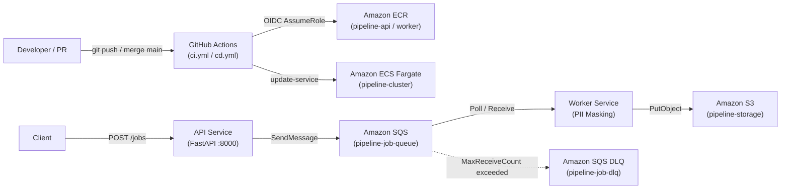

# Async Pipeline Docker (AWS + Terraform + GitHub Actions)

Asynchronous job processing pipeline built with **FastAPI**, **Worker** (PII masking & error simulation), **Amazon SQS**, **Amazon S3**, **Amazon ECR**, and **Amazon ECS Fargate**, provisioned with **Terraform** and deployed via **GitHub Actions**[cite: 1, 5].

## Architecture Overview



- **Provisioning (Terraform)**: Creates VPC, subnets, security group (`pipeline-app-sg`), SQS queues (`pipeline-job-queue`, `pipeline-job-dlq`), S3 bucket, IAM roles/OIDC provider, ECR repositories, and ECS cluster/services/task definitions[cite: 1].
- **CI/CD (GitHub Actions)**: Runs `pytest` and `docker build` on Pull Requests (`ci.yml`), and builds/pushes container images to ECR and updates ECS services on `main` (`cd.yml`).
- **Runtime Data Flow**: API accepts jobs via `POST /jobs`, enqueues them to SQS, processes PII masking in the worker, and persists results to S3 (with failed messages routed to DLQ).

## Prerequisites

- **OS / Shell**: Linux / WSL2 (Ubuntu) with `git` and `curl`[cite: 1, 4]
- **Containers**: Docker Engine & Docker Compose (for local testing)[cite: 1, 4]
- **AWS**: AWS CLI configured (`ap-northeast-1`) with credentials for Terraform[cite: 1]
- **IaC & CI/CD**: Terraform CLI, GitHub repository (`NakamuraToshiya/async-pipeline-docker`), and GitHub OIDC trust configured for the deploy IAM role[cite: 1, 4]

## Setup & Deployment

### 1. Provision Infrastructure (Terraform)

```bash
cd ~/terraform-pipeline
terraform init
terraform plan
terraform apply
```

### 2. Build & Deploy via CI/CD (GitHub Actions)

1. Push changes to a feature branch and open a Pull Request to run `ci.yml` (`pytest` and `docker build`).
2. Merge the Pull Request into `main` to run `cd.yml`, pushing images to Amazon ECR and updating ECS services.

### 3. Start / Stop ECS Tasks (Cost Control)

Scale tasks to `1` when verifying live traffic, and scale back to `0` when idle to avoid ongoing Fargate charges[cite: 1]:

```bash
aws ecs update-service \
  --cluster pipeline-cluster \
  --service pipeline-api-service \
  --desired-count 0 \
  --region ap-northeast-1

aws ecs update-service \
  --cluster pipeline-cluster \
  --service pipeline-worker-service \
  --desired-count 0 \
  --region ap-northeast-1
```

## Local Development (Docker Compose)

```bash
cd ~/day5-docker
docker compose up -d --build
docker compose ps
```

## Tear Down

```bash
cd ~/terraform-pipeline
terraform destroy
```